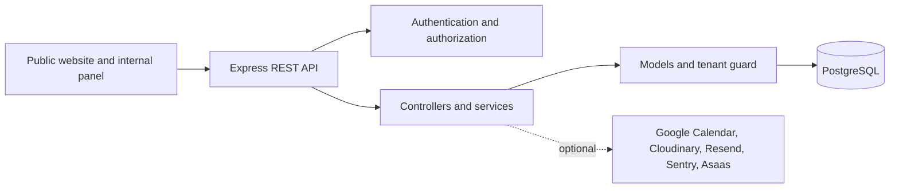

<p align="center">
  
</p>

<h1 align="center">ONE Communications Platform</h1>

<p align="center">
  A full-stack workspace for client relationships, campaigns, production workflows, calendars, analytics, and financial operations.
</p>

<p align="center">
  <a href="https://github.com/ricardoribs/one-comunicacao/actions/workflows/ci.yml"></a>
  
  
  
  <a href="LICENSE"></a>
</p>

<p align="center">
  <a href="#features">Features</a> |
  <a href="#architecture">Architecture</a> |
  <a href="#getting-started">Getting started</a> |
  <a href="#quality-and-security">Quality and security</a> |
  <a href="#license">License</a>
</p>

## Overview

ONE brings the public website and the internal operations panel into a single application. The Express backend serves the frontend, exposes a REST API, and enforces authentication, authorization, tenant isolation, and business rules.

The repository uses synthetic demonstration data and is designed to run locally without relying on hosted infrastructure.

## Features

| Area | Capabilities |
| --- | --- |
| Client operations | CRM, leads, client profiles, campaigns, and reports |
| Team workflow | Kanban boards, tasks, assignees, checklists, files, and notifications |
| Planning | Shared calendar, reminders, and optional Google Calendar integration |
| Business insights | Dashboards, analytics, billing, charges, and cost tracking |
| Access control | Role-based permissions, tenant scoping, RLS, session revocation, and MFA/TOTP |

## Architecture



### Technology stack

| Layer | Technologies |
| --- | --- |
| Backend | Node.js, Express, PostgreSQL, `node-pg-migrate` |
| Frontend | HTML, CSS, Tailwind CSS, vanilla JavaScript |
| Authentication | Short-lived JWTs, rotating refresh tokens, `HttpOnly` cookies, TOTP |
| Testing | Node.js test runner, Supertest, pg-mem |
| Quality | ESLint, npm audit, Gitleaks, CodeQL |

### Repository structure

```text
.
|-- backend/
|   |-- scripts/          # validation and maintenance utilities
|   |-- src/              # API, domain logic, database, and integrations
|   `-- test/             # automated tests
|-- frontend/             # public website and internal operations panel
|-- docs/
|   |-- api/              # OpenAPI contract
|   `-- architecture/     # technical architecture notes
`-- scripts/              # shared repository checks
```

See the [architecture notes](docs/architecture/ARCHITECTURE.md) and the [OpenAPI contract](docs/api/openapi.yaml) for more detail.

## Getting started

### Requirements

- Node.js 24
- PostgreSQL 16 or newer
- npm

### 1. Clone and install

```bash
git clone https://github.com/ricardoribs/one-comunicacao.git
cd one-comunicacao
npm ci
```

### 2. Configure the environment

Create a PostgreSQL database named `one_comunicacao`, then copy the example environment file:

```bash
cp .env.example .env
```

The default database URL in `.env.example` expects PostgreSQL at `localhost:5432`. Generate unique values for the secret and encryption variables before starting the application.

### 3. Prepare the database

```bash
npm run db:migrate
```

To create the first local administrator, temporarily configure:

```env
ALLOW_ADMIN_BOOTSTRAP=true
BOOTSTRAP_ADMIN_NAME=Local Administrator
BOOTSTRAP_ADMIN_EMAIL=admin@example.test
BOOTSTRAP_ADMIN_PASSWORD=<a strong password with at least 12 characters>
```

Run the bootstrap once, then set `ALLOW_ADMIN_BOOTSTRAP=false` again:

```bash
npm run bootstrap:admin
```

### 4. Start the application

```bash
npm run dev
```

| Service | URL |
| --- | --- |
| Public website | <http://localhost:3000/> |
| Internal panel | <http://localhost:3000/app/io> |
| Health check | <http://localhost:3000/api/health> |

## Useful commands

| Command | Purpose |
| --- | --- |
| `npm run dev` | Start the development server with automatic reload |
| `npm run db:migrate` | Apply pending database migrations |
| `npm run check:frontend` | Validate frontend JavaScript and HTML |
| `npm run lint` | Run ESLint on the backend |
| `npm test` | Run the complete backend test suite |
| `npm run verify:rls` | Verify tenant isolation and PostgreSQL RLS |
| `npm run validate:env` | Validate environment configuration |

## Environment variables

The [`.env.example`](.env.example) file documents the supported configuration. External services are optional and remain disabled until their variables are provided.

Never commit:

- `.env` files or access tokens;
- private keys and certificates;
- database dumps or backups;
- real customer, employee, or payment data.

Use different values for `JWT_SECRET`, `MFA_ENCRYPTION_KEY`, `FINANCIAL_ENCRYPTION_KEY`, and `GOOGLE_CALENDAR_TOKEN_ENCRYPTION_KEY`.

## Quality and security

The automated checks cover:

- secret scanning with Gitleaks;
- dependency auditing;
- backend linting and frontend syntax validation;
- integration, authentication, authorization, and tenant-isolation tests;
- CodeQL static analysis;
- authenticated smoke tests.

Demonstration scripts contain synthetic names, contact details, documents, and payment references only.

## License

Licensed under the [Apache License 2.0](LICENSE).
